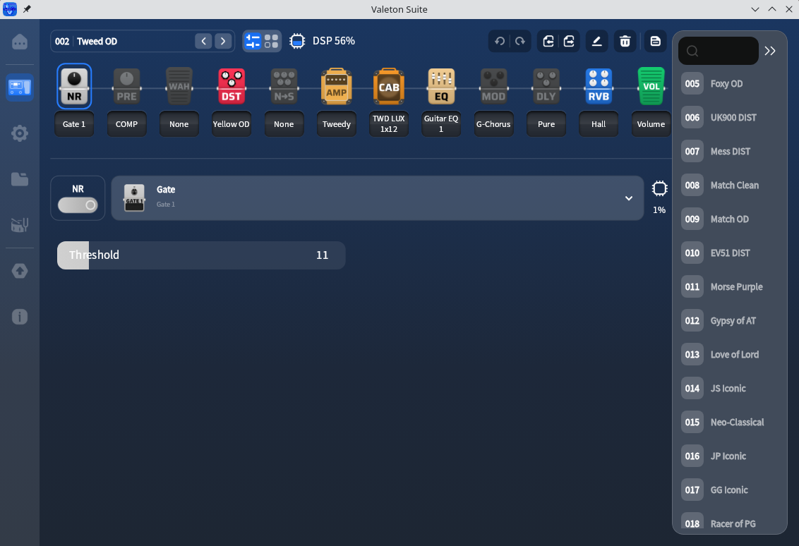

# Valeton Suite Wine patcher

Run Valeton Suite 2.1.0 for Windows x64 under Wine. The patch disables spoken accessibility prompts and enables CPU rendering.



## Requirements

- Python 3.10 or newer
- Wine
- [Valeton Suite 2.1.0 for Windows x64](https://www.valeton.net/download/)

The patcher uses only Python's standard library.

**Firmware upgrades have not been tested under Wine. A failed upgrade could brick the device, leaving it unusable. Avoid using Wine to upgrade pedal firmware.**

## Usage

### 1. Download and install Valeton Suite

Download **Valeton Suite 2.1.0 for Windows x64** from [Valeton's download page](https://www.valeton.net/download/). Extract the archive if the download is a ZIP file, then run the installer with Wine:

```sh
wine "$HOME/Downloads/Valeton Suite Setup V2.1.0 for Windows.exe"
```

Adjust the path if the installer is saved elsewhere. Complete the installation, then close Valeton Suite before applying the patch.

### 2. Patch the installed application

Run this command from the patcher's project directory:

```sh
python3 patch_valeton.py "$HOME/.wine/drive_c/Program Files/Valeton Suite/Valeton Suite/Valeton Suite.exe"
```

This example uses Wine's default installation path. For a different Wine prefix or installation directory, pass the path to its original `Valeton Suite.exe`.

The patcher creates two files beside the original executable:

- `Valeton Suite Wine.exe`: a copy with speech startup skipped.
- `run-valeton.sh`: a launcher that uses the patched copy and disables Direct3D 11 for that process.

The installed executable and DLLs remain unchanged. Running the patcher again keeps matching output files. It refuses to overwrite files with different contents.

To check whether an executable is supported without writing files:

```sh
python3 patch_valeton.py --check "/path/to/Valeton Suite.exe"
```

### 3. Start Valeton Suite

Run the generated launcher:

```sh
"$HOME/.wine/drive_c/Program Files/Valeton Suite/Valeton Suite/run-valeton.sh"
```

If the installation is inside a Wine prefix's `drive_c` directory, the launcher sets `WINEPREFIX` to that prefix. Otherwise it uses the caller's `WINEPREFIX`, or Wine's default prefix when that variable is unset. The launcher finds `wine` through `PATH`.

### 4. Update the Ubuntu launcher

The following `.desktop` file edit applies to both GNOME and KDE Plasma.

Edit the application menu entry created by Wine:

```sh
nano "$HOME/.local/share/applications/wine/Programs/Valeton Suite/Valeton Suite.desktop"
```

Replace its entire `Exec=` line with the full path to the generated script:

```ini
Exec="/home/YOUR_USERNAME/.wine/drive_c/Program Files/Valeton Suite/Valeton Suite/run-valeton.sh"
```

Replace `/home/YOUR_USERNAME` with your home directory. Adjust the installation path if needed. The `Exec=` line does not expand `$HOME` or `~`. Keep the existing `Icon=`, `Path=` and other entries.

Save the file. If there is a separate `.desktop` shortcut on the desktop, update its `Exec=` line too.

#### GNOME

Close any running Valeton Suite window. Press **Super**, search for **Valeton Suite**, and launch it from the results.

To replace a pinned dock shortcut, right-click it and select **Remove from Favorites**. Find Valeton Suite in the applications list, right-click it, and select **Add to Favorites**, as described in [GNOME's favorites guide](https://help.gnome.org/gnome-help/shell-apps-favorites.html).

#### KDE Plasma

If the menu still uses the old command, refresh its application cache. For Plasma 5:

```sh
kbuildsycoca5 --noincremental
```

For Plasma 6, use `kbuildsycoca6 --noincremental` instead.

## Supported build

Only the exact executable below is accepted. Other builds are refused, including files that have already been modified. A matching version label alone is insufficient.

| Property | Value |
| --- | --- |
| Version | Valeton Suite 2.1.0, Windows x64 |
| Original size | 101,632 bytes |
| Original SHA-256 | `cb4f7e546a69918c77eca62a524413f76e5ef9d373905be954d7b4f548bdcaa5` |
| Patched SHA-256 | `6bfae8ff704cbe857b2bbab3e52f1f7691b9236f8d617efb1dcf43268545885f` |

Tested on Ubuntu 24.04 with Wine 9.0 and a Valeton GP-150. Interface rendering and pedal connectivity work in this configuration without debug logging. Other pedals and Wine versions have not been tested.

After a Valeton update, check the new original executable before applying the patch. Support for a different build requires checking its startup code and adding the verified patch details.

## What changes

At file offset `0x280c`, the patcher replaces these six bytes:

```text
ff 15 06 40 00 00
```

with:

```text
90 90 90 90 90 90
```

The original instruction calls `FlutterTtsPluginRegisterWithRegistrar` through the executable's import table. Skipping it prevents the speech plugin from creating `Windows.Media.Playback.MediaPlayer` during startup. This works around a startup failure observed under Wine 9.0, where Wine reports that this class is missing. The plugin's startup code is in [flutter_tts](https://github.com/dlutton/flutter_tts/blob/master/windows/flutter_tts_plugin.cpp).

Spoken accessibility prompts are disabled in the patched copy. Valeton may print a `MissingPluginException` for `flutter_tts`.

The launcher sets `WINEDLLOVERRIDES="d3d11="`. This replaces any existing value of `WINEDLLOVERRIDES` for that launch. With Direct3D 11 disabled, [Flutter's Windows engine](https://github.com/flutter/engine/blob/main/shell/platform/windows/flutter_windows_engine.cc) can fall back to CPU rendering. This works around the black window observed under Wine 9.0. ANGLE and EGL initialization errors may still appear in the terminal.

The modified executable no longer matches Valeton's digital signature. The original executable retains its original bytes and signature.

The patch does not change USB or MIDI handling.

## Undo

Run the original `Valeton Suite.exe` and point any edited launchers back to their original command. Remove `Valeton Suite Wine.exe` and `run-valeton.sh` when no longer needed.

## Development

Run the tests:

```sh
python3 -m unittest -v
```

The tests use synthetic input files and a fake Wine command. Proprietary Valeton executables and DLLs are not included.

## AI disclosure

This software was developed with strong assistance from OpenAI's GPT models. Humans led the ideas, testing, debugging, and final decisions. We disclose this because it materially shaped how the project was built.

## Disclaimer

Use this patcher at your own risk. It is provided as is, without warranty. The authors are not responsible for device damage or data loss resulting from its use.
